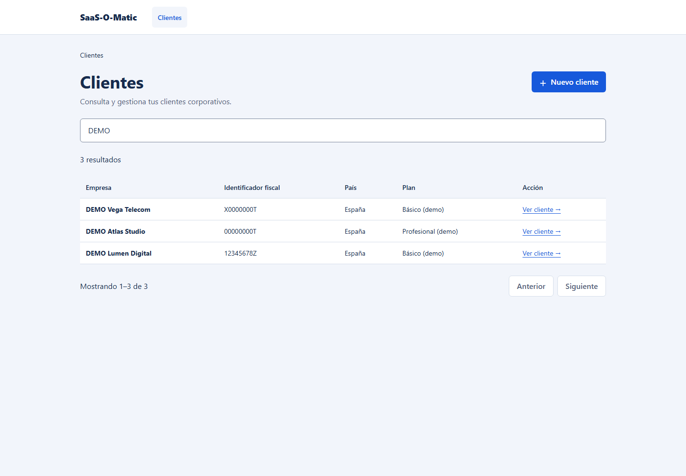
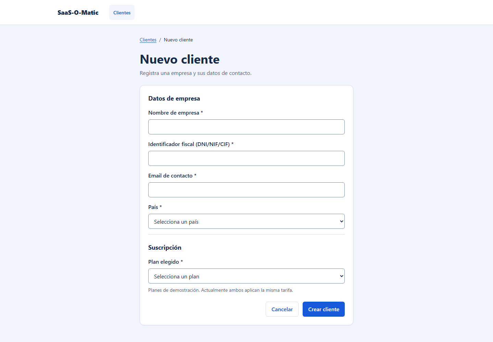
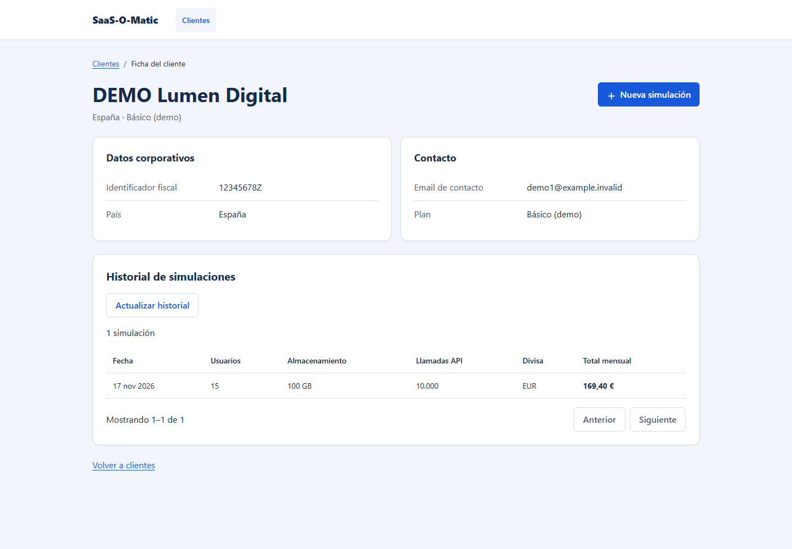
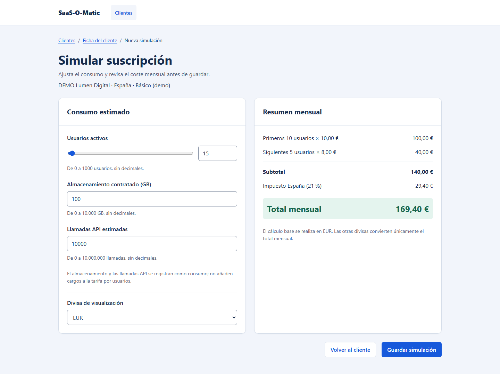
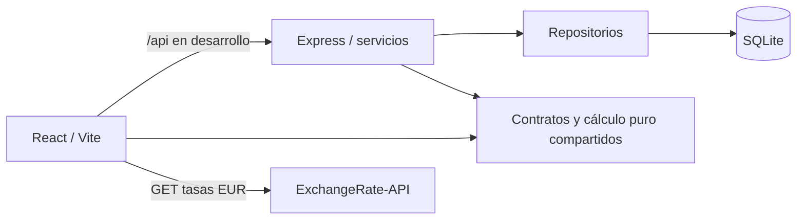

# SaaS-O-Matic — Prueba técnica de desarrollo con IA para Roams

Aplicación Full-Stack para registrar clientes corporativos y simular su coste mensual mediante facturación acumulativa por tramos, impuesto y conversión orientativa de divisas. El proyecto combina implementación incremental guiada por especificaciones con validación automatizada y documentación del desarrollo asistido por IA.

## Índice

- [Inicio rápido](#inicio-rápido)
- [Necesidades y alcance](#necesidades-y-alcance)
- [Pantallas principales](#pantallas-principales)
- [Arquitectura y decisiones de software](#arquitectura-y-decisiones-de-software)
- [Proceso de especificación y uso de IA](#proceso-de-especificación-y-uso-de-ia)
- [Configuración y operación](#configuración-y-operación)
- [Pruebas y evidencia](#pruebas-y-evidencia)
- [Limitaciones y entrega](#limitaciones-y-entrega)

## Inicio rápido

### Requisitos

- Node.js **>=22.13.0 y <23**, validado en Windows con 22.19.0.
- pnpm **10.33.4**, fijado en `packageManager`, y Git para obtener el código.
- Acceso a red para dependencias y, opcionalmente, tasas FX. No hace falta instalar un servidor SQLite.

Desde la raíz de una copia del repositorio:

```sh
pnpm install --frozen-lockfile
```

`better-sqlite3` es una dependencia nativa. La instalación necesita su binario compatible o un entorno de compilación nativa si no está disponible para la plataforma. El lockfile y la configuración de pnpm forman parte de la entrega; no se deben regenerar para resolver un fallo de entorno sin diagnosticarlo.

Si pnpm no está disponible, esta alternativa PowerShell lo instala dentro del proyecto, sin cambiar la configuración global:

```powershell
npm.cmd install --prefix .tools --no-package-lock --no-audit --no-fund --cache .cache/npm pnpm@10.33.4
$env:Path = "$PWD\.tools\node_modules\.bin;$env:Path"
pnpm.cmd install --frozen-lockfile
```

En PowerShell puede usarse `pnpm.cmd` para evitar el bloqueo de `pnpm.ps1`. La modificación del PATH dura únicamente esa terminal. `.tools` y `.cache` están ignorados por Git.

### Crear la demo y arrancar

La demo completa crea **una base nueva con tres clientes ficticios y una simulación por cliente**. Usa el mismo control fiscal, servicios y motor que la aplicación. Los identificadores tienen formato/control válido como fixture; no acreditan identidad real o alta censal. Correos bajo `example.invalid`.

PowerShell, desde la raíz y en la misma terminal:

```powershell
$env:DATABASE_KIND = 'demo'
$env:DATABASE_PATH = 'apps/api/data/roams-demo.sqlite'
pnpm.cmd db:demo:setup
pnpm.cmd dev
```

POSIX:

```sh
export DATABASE_KIND=demo
export DATABASE_PATH=apps/api/data/roams-demo.sqlite
pnpm db:demo:setup
pnpm dev
```

- Web: <http://127.0.0.1:5173/customers>.
- API: <http://127.0.0.1:3000>.
- Salud: `GET /health` devuelve `{"status":"ok"}`.
- Detener web/API con `Ctrl+C`. Las variables deben conservarse al arrancar la API en otra terminal.

**El destino debe ser nuevo.** Repetir `db:demo:setup` devuelve `DB_ALREADY_EXISTS` y conserva el archivo existente. Para una nueva demo, elegir otro nombre; no borrar la base de desarrollo. El comando valida rutas, marca la base como demo, aplica migraciones y guarda datos mediante los servicios existentes. Si la inicialización falla, el helper retira exclusivamente el archivo que acaba de crear.

| Cliente ficticio   | Plan demo   | Usuarios | Almacenamiento GB | Llamadas API | Total EUR |
| ------------------ | ----------- | -------- | ----------------- | ------------ | --------- |
| DEMO Lumen Digital | Básico      | 15       | 100               | 10.000       | 169,40 €  |
| DEMO Atlas Studio  | Profesional | 50       | 250               | 50.000       | 508,20 €  |
| DEMO Vega Telecom  | Básico      | 60       | 500               | 100.000      | 568,70 €  |

Estos totales resultan de la política demo española del 21 %. IDs y fechas se generan al crear la demo; no se prometen registros idénticos byte a byte. El seed histórico `db:seed` se conserva por compatibilidad con 002 y es distinto: solo crea dos clientes técnicos sin simulaciones. **No hace falta ejecutarlo para esta demo.**

Para salir del contexto demo en PowerShell:

```powershell
Remove-Item Env:DATABASE_KIND
Remove-Item Env:DATABASE_PATH
```

En POSIX: `unset DATABASE_KIND DATABASE_PATH`. Si se desea trabajar con una base de desarrollo vacía, ejecutar `pnpm db:migrate` y después `pnpm dev` sin esas variables. No hay creación/migración automática al arrancar.

## Necesidades y alcance

El enunciado se resume aquí; las [reglas y contratos](docs/api-contracts.md) y la [matriz de verificación](specs/009-quality/validation.md#qa-review-009--matriz-final-del-enunciado) contienen el detalle y sus límites.

| Necesidad                                                              | Solución implementada                                                                                   | Specs         |
| ---------------------------------------------------------------------- | ------------------------------------------------------------------------------------------------------- | ------------- |
| Alta corporativa con empresa, identificador fiscal, email, país y plan | Formulario conectado a `POST /customers`; validación y duplicados por país/identificador normalizado    | 002, 003, 007 |
| Control fiscal español                                                 | Algoritmos de control de DNI/NIF/NIE y entidades; formato/control, sin consulta censal                  | 003           |
| Simulación persistida                                                  | `POST /simulations`, consumos, importes EUR y snapshots históricos                                      | 002, 005, 008 |
| Tarificación gradual                                                   | Primeros 10 usuarios a 10 €, siguientes 40 a 8 €, restantes a 5 €; impuesto después de la base completa | 004, 005      |
| Consulta comercial                                                     | Búsqueda por empresa/fiscal, ficha e historial paginado, interfaz responsive                            | 003, 007, 008 |
| Proyección dinámica y divisas                                          | Preview compartido, guardado autoritativo, total EUR/USD/GBP mediante ExchangeRate-API                  | 006, 008      |
| Calidad y trazabilidad del trabajo con IA                              | Specs, controles, revisión de seguridad básica y evidencias con procedencia                             | 001–010       |

Ejemplo: 15 usuarios = 10 × 10 € + 5 × 8 € = 140 € de base; con la política demo de España, 29,40 € de impuesto y 169,40 € de total.

Los planes `DEMO_BASIC` y `DEMO_PRO`, países/impuestos configurados y límites de consumo son decisiones complementarias acordadas para la prueba. **El plan no modifica el precio y almacenamiento/llamadas se registran sin añadir cargos.** No representan un catálogo comercial real.

## Pantallas principales

Capturas reales de la aplicación en Chromium con API/SQLite temporales y datos ficticios, independientes de la base local. El listado se muestra filtrado por DEMO para centrar la captura en los clientes creados para ilustración. No son mockups ni imágenes generadas por IA.

### Clientes



### Alta corporativa



### Ficha e historial



### Simulador



## Arquitectura y decisiones de software

Se utiliza un monolito modular con dos aplicaciones y un paquete compartido. La estructura mantiene separadas las responsabilidades que existen en el reto y permite ejecutar el conjunto desde la raíz.

```text
apps/
  web/       React, rutas, componentes, estado y adaptadores HTTP/FX
  api/       Express, validación, servicios, dominio fiscal y repositorios SQLite
packages/
  shared/    Contratos TypeScript, parsers y dominio puro de facturación/divisas
specs/       Requisitos, aclaraciones, planes, tareas y validación por entrega
ai-workspace/  Índice y evidencias del desarrollo asistido, con procedencia
```



| Decisión                                 | Motivo y consecuencia                                                                                                                                                                                                                               |
| ---------------------------------------- | --------------------------------------------------------------------------------------------------------------------------------------------------------------------------------------------------------------------------------------------------- |
| pnpm workspaces                          | Gestionar apps y shared en un repositorio con versiones fijadas y enlaces workspace. Evita publicar un paquete para compartir contratos dentro de la prueba.                                                                                        |
| React + TypeScript + Vite; Express + tsx | Stack inicial solicitado. TypeScript estricto cruza frontend/backend; Vite y tsx permiten iterar con herramientas acotadas. No se migró a otro framework.                                                                                           |
| SQLite + Drizzle + better-sqlite3        | Persistencia local sin servidor adicional, esquema tipado y transacciones. Las migraciones SQL se versionan y verifican. El driver nativo condiciona la instalación y SQLite requiere almacenamiento persistente si se despliega.                   |
| Capas según responsabilidad              | Controladores adaptan HTTP; parsers validan; servicios coordinan; dominio calcula; repositorios contienen SQL. No introducir interfaces/capas sin una necesidad concreta.                                                                           |
| Backend autoritativo                     | La web ofrece preview con el motor compartido, pero el servidor recalcula al guardar. Se comprueba compatibilidad de configuración y se muestra el resultado definitivo si difiere.                                                                 |
| Céntimos, BigInt y half-up               | Evitar errores acumulativos de coma flotante. Impuesto sobre la base completa y redondeo explícito; JSON contiene enteros seguros. No fue necesario añadir una librería decimal.                                                                    |
| Histórico inmutable                      | Cada simulación conserva consumos, importes, versiones y snapshot del cliente. El historial se lee sin recalcular con tarifas o datos actuales.                                                                                                     |
| FX solo de presentación                  | Consulta directa del navegador, caché en memoria por pestaña hasta caducidad y timeout de 5 s. Solo se convierte el total; desglose/histórico permanecen EUR. Si falla FX, se mantiene EUR y se permite guardar. No se persisten tasas/convertidos. |
| CSS Modules + tokens globales            | Estilos locales y valores visuales centralizados, con fuente del sistema, navegación superior y React Router. Sin librería UI, Tailwind o tema oscuro añadidos.                                                                                     |
| Errores y guardado incierto              | Mensajes sanitizados, campos conservados y doble envío bloqueado. Red/timeout/201 ilegible no disparan reintentos automáticos de POST; se ofrece comprobar el historial.                                                                            |
| Integridad y privacidad                  | Consultas parametrizadas, límites de entrada, unicidad fiscal por país, rutas DB restringidas y operaciones explícitas. Los tests utilizan contextos temporales, no datos de desarrollo.                                                            |
| Calidad proporcional                     | node:test para dominio/API/DB, Vitest/RTL para consumidores web y Playwright/Chromium para flujos. Se combinan oráculos de importes, pruebas negativas y revisión visual; una captura no sustituye una prueba funcional.                            |

No se añadieron Prisma, servidor de bases de datos, microservicios, UI kit o librerías monetarias. Algunas decisiones fueron delegadas; otras fueron confirmadas explícitamente. La tabla resume el estado y sus consecuencias, no pretende reconstruir alternativas debatidas que no estén registradas.

Detalles: [arquitectura](docs/architecture.md), [modelo y recuperación](docs/data-model.md), [decisiones](docs/decisions.md), [constitución](docs/constitution.md) y [contratos](docs/api-contracts.md). Los documentos por tarea conservan estados históricos; las validaciones de cierre indican el resultado posterior.

## Proceso de especificación y uso de IA

El trabajo se dividió en entregas pequeñas, con requisitos, aclaraciones, plan, tareas y validación. Las tareas se autorizaron incrementalmente; antes de implementar se adaptaron las propuestas al código existente y se resolvieron decisiones de producto o arquitectura.

| Spec                                                     | Responsabilidad y relación                                                                                                          |
| -------------------------------------------------------- | ----------------------------------------------------------------------------------------------------------------------------------- |
| [001 Foundation](specs/001-foundation/spec.md)           | Workspaces, aplicaciones base, controles y scripts. La retrospectiva documenta que parte del scaffolding precedió a su spec formal. |
| [002 Persistence](specs/002-persistence/spec.md)         | SQLite, migraciones, contratos persistentes, integridad y herramientas seguras.                                                     |
| [003 Customers API](specs/003-customers-api/spec.md)     | Alta, control fiscal, búsqueda y detalle sobre la persistencia existente.                                                           |
| [004 Billing](specs/004-billing/spec.md)                 | Dominio puro de tramos, dinero e impuesto, reutilizable por API/web.                                                                |
| [005 Simulations API](specs/005-simulations-api/spec.md) | Cálculo autoritativo y guardado, histórico y configuración.                                                                         |
| [006 Currency](specs/006-currency/spec.md)               | Conversión exacta y cliente FX sin interfaz todavía.                                                                                |
| [007 Customers UI](specs/007-customers-ui/spec.md)       | Diseño compartido, listado, alta operativa, ficha e historial.                                                                      |
| [008 Simulator UI](specs/008-simulator-ui/spec.md)       | Preview/FX, guardado confirmado, discrepancias y navegación al historial.                                                           |
| [009 Quality](specs/009-quality/spec.md)                 | Revisión integrada, accesibilidad/responsive, seguridad básica y corrección de defectos.                                            |
| [010 Delivery](specs/010-delivery/spec.md)               | README, demo, auditoría y ensayo de entrega. T01 no equivale al ensayo limpio de T03.                                               |

**Codex** se ha utilizado para ejecutar código, implementar tareas y realizar controles bajo las directrices del proyecto. **ChatGPT Work con el complemento Product** se ha utilizado para el diseño general de interfaces. Las referencias visuales se adaptaron al alcance y contratos reales antes de implementar las pantallas.

La intervención humana definió alcance, resolvió decisiones, autorizó tareas y revisó resultados. Las instrucciones para la IA están en [AGENTS.md](AGENTS.md), [constitución](docs/constitution.md) y [procedimiento SDD](docs/sdd-harness.md): dominio puro, backend autoritativo, dinero exacto, datos preservados y pruebas observables.

El [índice de auditoría](ai-workspace/README.md) reúne planificación, arquitectura, instrucciones, iteraciones y evidencias. Los prompts reformulados y registros retrospectivos deben identificarse como tales; no son transcripciones originales. La incorporación de 008/009/010 se realiza en T02 por autorización de Alex, con retrospectivas identificadas y enlaces a sus specs/validaciones canónicas. No se atribuyen sesiones, versiones de herramientas o prompts de diseño que no estén conservados.

## Configuración y operación

No hace falta un archivo `.env` y no se carga automáticamente. Exportar variables en la terminal; [.env.example](.env.example) documenta los nombres. API y comandos DB consumen la misma selección de base.

| Variable        | Valor predeterminado       | Uso                                                                                                          |
| --------------- | -------------------------- | ------------------------------------------------------------------------------------------------------------ |
| `PORT`          | `3000`                     | Puerto API; el proxy Vite de desarrollo apunta a 3000. Si se cambia, adaptar también su destino.             |
| `DATABASE_PATH` | `apps/api/data/dev.sqlite` | Ruta respecto a la raíz, incluso ejecutando desde otro directorio. Solo bajo apps/api/data o .cache.         |
| `DATABASE_KIND` | `development`              | Propietario esperado: development/demo. La demo completa exige demo y ruta explícita distinta de dev.sqlite. |

| Comando desde raíz                                       | Función                                                               |
| -------------------------------------------------------- | --------------------------------------------------------------------- |
| `pnpm dev`                                               | Compila shared y ejecuta web/API en paralelo.                         |
| `pnpm dev:web` / `pnpm dev:api`                          | Arranque separado; mantener selección DB en la terminal de API.       |
| `pnpm build`                                             | Compila todos los paquetes.                                           |
| `pnpm start:api`                                         | Arranca API compilada después de build. No sirve el frontend.         |
| `pnpm db:demo:setup`                                     | Crea demo completa en destino nuevo explícito.                        |
| `pnpm db:migrate`                                        | Crea/actualiza base reconocida; no altera migraciones aplicadas.      |
| `pnpm db:backup --out apps/api/data/backup-nuevo.sqlite` | Backup a archivo nuevo de la base seleccionada; no sobrescribe.       |
| `pnpm db:generate`                                       | Genera migraciones para revisión; no necesario para arrancar/evaluar. |

`/health` y `/billing-config` funcionan sin DB. Los endpoints de datos pueden devolver 503 si falta la base o hay migraciones pendientes. Crear un backup antes de migrar una base existente. El arranque no incluye reset, seed ni migraciones implícitos.

La web consulta `/api`; Vite retira el prefijo y reenvía al backend local en desarrollo. El build web no incluye ese proxy. Una publicación futura debe resolver SPA/rutas directas y `/api`, configuración de entorno y persistencia SQLite por separado.

## Pruebas y evidencia

```sh
pnpm lint
pnpm typecheck
pnpm format:check
pnpm build
pnpm test
# Solo la primera vez en ese entorno:
pnpm --filter @saas-o-matic/web test:e2e:install
pnpm test:e2e
```

`pnpm test` compone unitarias, integración, web, gates y documentos. `test:e2e` es independiente y crea API/Vite/SQLite propios, con puertos efímeros y FX controlado; no requiere servidores personales. Chromium se descarga en `.cache/playwright`. El reporte JSON, capturas y trazas de fallo se generan en `.cache/007-e2e`, nombre heredado; son artefactos efímeros.

**No ejecutar test:gates en paralelo con lint, tipos, build u otros controles de código.** El gate introduce errores temporales propios para verificar que las herramientas los rechazan. Pueden ejecutarse suites individuales con `test:unit`, `test:integration`, `test:web` y `test:docs`; ver [guía de pruebas](docs/testing.md).

[009 cerró técnicamente](specs/009-quality/validation.md#t05--verificación-final-y-cierre-técnico) con 273 pruebas generales y 36 E2E. Son resultados de esa versión, no prueba automática de una instalación limpia de 010. Los resultados de esta entrega se registran en [validación 010](specs/010-delivery/validation.md). La consulta real FX/CORS de 009-T02 tiene evidencia separada de los fixtures.

## Limitaciones y entrega

- Política de simulación simplificada: ES 21 %, FR 20 %, DE 19 %, GB 20 %. No fiscalidad completa, exenciones o asesoramiento tributario.
- Usuarios 0–1.000, almacenamiento 0–10.000 GB y llamadas API 0–10.000.000, enteros. Son guardas acordadas, no cuotas comerciales oficiales.
- Sin autenticación/autorización, catálogo comercial real, idempotencia avanzada o despliegue de producción. Dos guardados deliberados pueden crear dos simulaciones.
- Conversión dependiente de disponibilidad/CORS del proveedor. La comprobación local puntual no garantiza el funcionamiento en un futuro dominio público. Importes guardados siempre EUR.
- Validación de interfaz en Chromium a cuatro anchos y ampliación CSS/reflujo; no certificación completa de accesibilidad, otros navegadores, lectores de pantalla o zoom nativo.
- El ensayo de instalación limpia de 010-T03 y la preparación externa de T04 siguen pendientes. Entrega local y repositorio son el alcance obligatorio; demo desplegada opcional, sin hosting elegido.
- Se excluyen secretos, .env reales, DB/backups, node_modules y cachés. Los PDF aportados se consultaron como fuentes externas y no se incorporan automáticamente. No se publica ni se hace commit/push desde estas instrucciones.

La conformidad técnica y la aceptación humana final se registran por separado. El objetivo es que el evaluador pueda comprobar el comportamiento y recorrer las decisiones con evidencia, incluidos los límites que quedan fuera de esta prueba.
