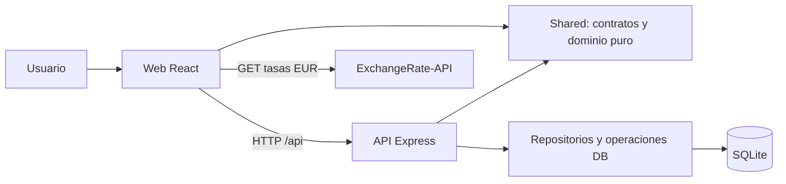
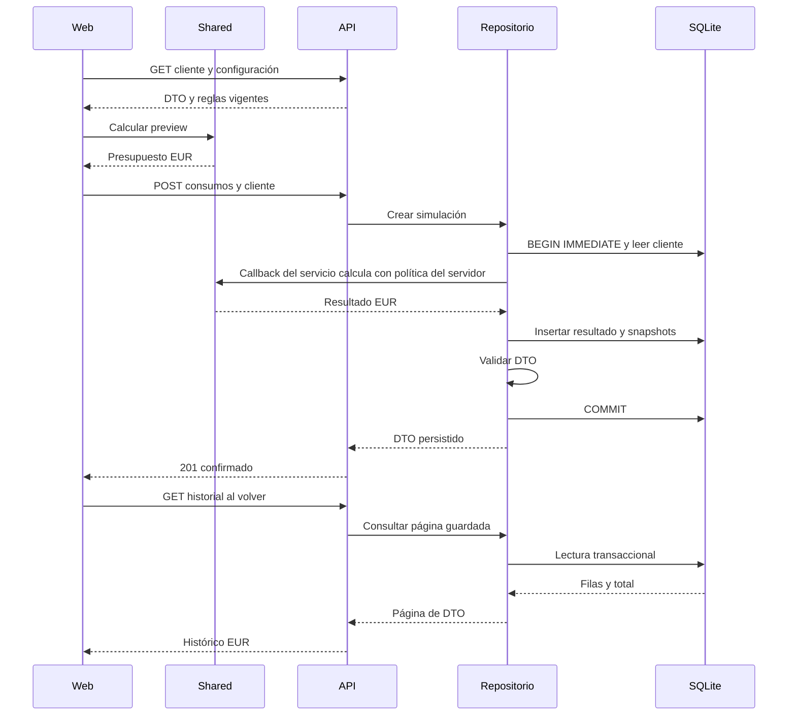

# Arquitectura técnica de SaaS-O-Matic

## 1. Visión general

SaaS-O-Matic es una aplicación Full-Stack organizada como monorepo pnpm: una SPA React, una API Express y un paquete compartido de contratos y dominio. El backend es un monolito modular con persistencia SQLite local; no hay microservicios ni servidor de bases de datos separado.

El stack implementado utiliza TypeScript estricto y módulos ESM, React con Vite y React Router, Node.js con Express, Drizzle ORM y better-sqlite3. La conversión orientativa consulta un proveedor externo desde el navegador, fuera del circuito de persistencia.



Las flechas hacia shared representan dependencias de código, no un servicio desplegado. En desarrollo Vite reenvía `/api` a Express retirando el prefijo. Una publicación estática necesita resolver esa comunicación por separado.

Principios vigentes: dominio sin React/HTTP/SQL, contratos públicos sin tipos ORM, validación en fronteras, cálculo autoritativo en servidor y conservación del resultado histórico. Las responsabilidades se separan donde existen, sin imponer todas las capas a operaciones simples.

## 2. Estructura del repositorio

```text
apps/
  web/src/
    app/                  Rutas, layout y navegación
    features/customers/   Clientes e historial
    features/simulations/ Simulador, preview y guardado
    features/currency/    Contrato externo y cliente FX
    styles/               Tokens y estilos globales
  api/src/
    app.ts                Composición Express
    index.ts              Arranque y cierre
    features/             Clientes, simulaciones y configuración
    config/               Política fiscal del servidor
    http/                 Protocolo JSON y errores
    db/                   Conexión, esquema y operaciones
packages/
  shared/src/             Contratos, validadores y dominio puro
```

Web y API declaran `@saas-o-matic/shared` mediante `workspace:*`. Shared exporta JavaScript compilado y declaraciones desde `dist/index`; los consumidores usan su entrada pública, sin importar fuentes internas de otro paquete. Los scripts preparan ese build antes de los consumidores cuando es necesario.

No hay dependencia del paquete compartido hacia Express, Drizzle o React. La web no importa configuración privada ni repositorios de la API. Algunos adaptadores de clientes son reutilizados por simulaciones porque ya validan los mismos DTO y transporte; no existe una segunda infraestructura HTTP paralela.

La configuración base de TypeScript activa strict, comprobación de accesos indexados y propiedades opcionales exactas. El monorepo mantiene lockfile y workspaces como parte de la instalación reproducible.

## 3. Arquitectura frontend

La SPA utiliza BrowserRouter y [rutas declarativas](../apps/web/src/app/AppRoutes.tsx). Un layout común concentra cabecera, breadcrumbs, salto al contenido y foco de navegación. Los destinos funcionales son listado, alta, ficha e historial y simulador contextual del cliente; no existe una sección global de simulaciones ni detalle individual de simulación.

Cada feature distingue tres responsabilidades:

- **Adaptadores:** peticiones HTTP y validación runtime de respuestas desconocidas, incluidas identidad y coherencia del resultado.
- **Estado:** hooks para recursos asíncronos, borradores, preview, divisas y envío; coordinación de cancelación, vigencia y reintento.
- **Presentación:** páginas y componentes con CSS Modules y tokens comunes. La referencia visual está en [diseño](design.md).

El estado es local de React y del router; no se utiliza un gestor global adicional. Búsqueda y paginación se representan en URL, mientras el contexto de retorno se transporta como estado de navegación validado. El listado aplica debounce y descarta respuestas obsoletas.

`useApiResource` comparte carga, aborto y recuperación explícita de GET. Ficha e historial mantienen recursos independientes: un fallo del historial no invalida los datos del cliente. Los adaptadores de lectura validan la estructura almacenada sin aplicar de nuevo las reglas de alta a filas históricas.

El transporte común de web aplica timeout de 10 segundos, cancelación y clasificación de errores HTTP, red y protocolo. Los envíos no se disparan desde efectos ni se repiten automáticamente. Los formularios conservan entradas ante errores y bloquean doble envío.

El simulador separa borrador textual, consumos válidos, presupuesto previo y resultado confirmado. Configuración y cliente se cargan sin consultas por cada cambio de consumo. Se comprueba la compatibilidad de precios, tramos y límites con shared antes de habilitar un preview fiable.

Tras guardar, la pantalla proyecta el DTO confirmado sin recalcularlo y compara con el preview congelado. La conversión usa el total confirmado. Preparar otra simulación reinicia explícitamente el borrador y consulta de nuevo el contexto.

## 4. Arquitectura backend

[createApp](../apps/api/src/app.ts) compone Express sin abrir un puerto. [index.ts](../apps/api/src/index.ts) aporta el proveedor de datos, inicia listen y coordina cierre de servidor/conexión ante señales. Esta separación permite componer la aplicación con dependencias controladas.

Las features de clientes y simulaciones separan:

| Capa          | Responsabilidad                                           |
| ------------- | --------------------------------------------------------- |
| Rutas         | Montaje de endpoints y middleware de protocolo.           |
| Controladores | Parse de body, parámetros y query; respuesta HTTP.        |
| Servicios     | Orquestación de casos de uso y dominio.                   |
| Repositorios  | Consultas, transacciones y proyección desde persistencia. |

La configuración de facturación se publica directamente desde fuentes reales de dominio y política del servidor, sin repositorio o conexión DB innecesarios. Health tampoco requiere base de datos.

Los parsers compartidos rechazan coerciones, campos extra y valores fuera de contrato antes de solicitar una conexión. En clientes, el servicio aplica el control fiscal español mediante dominio puro específico de API; persistencia protege además unicidad por país e identificador normalizado.

El proveedor DB abre la conexión de forma lazy, verifica propietario y esquema vigente y reutiliza la conexión abierta. Si falla la apertura, cierra cualquier conexión parcial y permite una solicitud posterior; no crea ni migra la base implícitamente.

La composición acepta proveedor de conexión, logger y política fiscal internos. La inyección permite aislamiento y variaciones controladas; no permite al consumidor HTTP elegir tarifas o políticas. Los [contratos API](api-contracts.md) detallan rutas, DTO y errores.

## 5. Dominio y lógica de negocio

El motor de `packages/shared/src/billing` calcula base acumulativa por tramos, impuesto y desglose mediante funciones puras. Recibe consumos, país y una política fiscal explícita; precios y versión de tramos proceden del propio dominio. No consulta DB, red o reloj ni conoce Express o React.

La política fiscal versionada se define en API. La web la obtiene de la configuración pública y usa el mismo motor para el preview; al guardar, el servidor obtiene el país del cliente persistido y vuelve a calcular. Planes y consumos secundarios no introducen cargos inventados. Las reglas detalladas pertenecen a [reglas de negocio](business-rules.md).

Dinero se representa en céntimos enteros seguros; operaciones intermedias usan BigInt, redondeo half-up explícito y conversión segura antes de serializar. El redondeo fiscal se realiza sobre la base completa. Las funciones rechazan importes inseguros o políticas inválidas, sin devolver presupuestos parciales.

La conversión pura reside en `shared/src/currency`: transforma una tasa decimal validada y acotada en una razón exacta y redondea una sola vez al final. EUR es identidad; USD/GBP afectan solo al total. No se convierten líneas ni se persisten tasas FX.

En web, `features/currency` separa validación del payload externo y transporte. El cliente consulta ExchangeRate-API con base EUR, valida tasas y fechas, conserva atribución y comparte petición/caché inmutable por instancia de pestaña hasta caducidad. Su timeout de 5 segundos cubre fetch y lectura del cuerpo.

La adaptación React reutiliza ese cliente sin una segunda caché ni abortar peticiones compartidas al desmontar. La consulta depende de divisa y reintento, no del importe. Temporizador, foco y visibilidad retiran tasas vencidas; fallos conservan EUR con recuperación explícita.

## 6. Datos y persistencia

SQLite usa better-sqlite3 como driver síncrono y Drizzle para esquema y consultas. El modelo relaciona clientes con simulaciones; tablas de metadatos y migraciones identifican propietario, tipo de base y estado del esquema. El [modelo de datos](data-model.md) es la referencia de entidades, restricciones y recuperación.

Las tablas STRICT, claves foráneas, índices, CHECK y triggers refuerzan integridad y protección del histórico. La validación de aplicación sigue siendo necesaria: las garantías de SQLite no sustituyen el contrato JSON.

El SQL versionado reside en `apps/api/drizzle`. El runner registra hashes y rechaza deriva; aplica el lote de migraciones dentro de una transacción. Drizzle Kit genera SQL y un finalizador añade garantías STRICT/triggers al SQL nuevo. Generar y aplicar son operaciones distintas; ninguna forma parte del arranque HTTP.

La simulación guarda consumos, importes EUR, impuesto, desglose, versiones y snapshots de empresa, identificador fiscal, país y plan. Las lecturas históricas proyectan lo persistido sin consultar la política actual o sustituir snapshots por datos actuales del cliente.

El repositorio de alta controla una transacción inmediata: lee cliente, ejecuta el callback de cálculo síncrono del servicio y reutiliza la inserción existente. La operación interior usa un savepoint; el mapping se valida antes del commit. No se realiza red ni trabajo asíncrono dentro de esa transacción.

El historial comprueba existencia de cliente, total y página bajo transacción de lectura, con paginación SQL y orden estable por fecha/id descendentes. Un cliente ausente se distingue de uno sin simulaciones.

Conexión y CLI restringen destinos, reconocen archivos propios y separan desarrollo, demo y test. Migraciones, seed, demo completa y backup son comandos explícitos. La demo completa exige destino nuevo; el backup usa el driver sobre un archivo nuevo. No hay reset o restauración automática destructiva.

## 7. Recorrido completo de una simulación

1. React obtiene cliente y configuración, valida formato/compatibilidad y mantiene los consumos como borradores editables.
2. Con consumos válidos, shared calcula el preview y su impuesto con la política recibida. Una entrada inválida retira el resultado anterior como presupuesto vigente.
3. Si se solicita USD/GBP, web obtiene tasas y convierte solo el total EUR, sin cambiar el preview base o persistir la conversión.
4. Al guardar, se congelan consumos y preview y se envían únicamente customerId, users, storageGb y apiCalls.
5. API valida la entrada. El repositorio lee al cliente bajo transacción y el servicio calcula con la política interna del servidor.
6. Se guardan resultado y snapshots, se valida el DTO y se confirma el commit antes de responder 201.
7. Web presenta el resultado autoritativo y cualquier discrepancia. Al volver a la ficha, el historial consulta los datos guardados en EUR, sin motor o FX.



El diagrama omite la consulta FX opcional, independiente del guardado. Si el transporte falla después del commit, el navegador puede desconocer el resultado: cancelar o agotar un timeout no acredita rollback. La interfaz ofrece comprobar el historial sin reenviar automáticamente.

## 8. Aspectos transversales

- **Errores y observabilidad:** middleware central con códigos estables, mensajes públicos sanitizados y requestId generado por petición. Logs registran método, estado y código, sin cuerpos, identificadores fiscales, SQL o stacks. La cabecera x-powered-by está deshabilitada.
- **Validación:** contratos compartidos y validación runtime de respuestas en web; repositorios y DB refuerzan estructura e integridad. No se confía en un cast TypeScript como control de datos externos.
- **Protocolo:** POST requiere application/json y limita cuerpo a 32 KB. Query y paginación tienen claves y rangos admitidos; consultas parametrizadas tratan entradas como datos.
- **Configuración:** GET de facturación proyecta precios/versiones, tasas y límites desde fuentes reales, mediante copias y Cache-Control no-store, sin abrir DB.
- **Concurrencia:** recursos GET cancelables y protección de vigencia en web; una petición FX compartida; envío único mientras está pendiente. SQLite usa transacciones cortas y busy_timeout de 1000 ms; ocupación se traduce a 503.
- **Recuperación:** no hay reintentos automáticos de POST ni deduplicación de guardados deliberados. Un segundo guardado deliberado puede crear otra simulación; no existe idempotency-key.
- **Seguridad y límites:** no hay autenticación, autorización o aislamiento multi-tenant. FX recibe una consulta de tasas sin importes o datos privados. El protocolo y las validaciones no equivalen a un perímetro de producción completo.

## 9. Decisiones arquitectónicas

| Decisión vigente                   | Motivo y consecuencia                                                                                                                         |
| ---------------------------------- | --------------------------------------------------------------------------------------------------------------------------------------------- |
| Monorepo y shared                  | Reutilizar contratos y reglas entre web/API con herramientas comunes; requiere preparar exports compilados.                                   |
| Dominio puro                       | Probar cálculo de forma determinista y evitar una segunda implementación en UI; persistencia y transporte permanecen separados.               |
| SQLite y Drizzle                   | Persistencia local sin servidor adicional, SQL inspeccionable y transacciones; driver nativo y síncrono, sin promesa de escalado distribuido. |
| Snapshots e histórico EUR          | Conservar el hecho guardado ante cambios de cliente o política; la consulta no reproduce reglas actuales.                                     |
| FX desacoplado                     | Conversión orientativa sin alterar facturación o DB; depende de disponibilidad/CORS y solo admite el catálogo acordado.                       |
| Estado local y módulos por feature | Mantener complejidad proporcional, compartir adaptadores y hooks con uso real y separar presentación de orquestación.                         |
| Estilos locales y tokens           | Consistencia visual sin UI kit o sistema de temas adicional; detalles en la referencia de diseño.                                             |

Estas razones describen elecciones documentadas, no decisiones humanas inventadas ni una arquitectura universalmente óptima. Fuentes: aclaraciones de [persistencia](../specs/002-persistence/clarifications.md), [dominio](../specs/004-billing/clarifications.md), [API de simulaciones](../specs/005-simulations-api/clarifications.md), [divisas](../specs/006-currency/clarifications.md) e [interfaces](../specs/007-customers-ui/clarifications.md). El proceso de colaboración está en [ai-workspace/features](../ai-workspace/features/).

## 10. Ejecución y despliegue

El repositorio declara Node >=22.13.0 y <23 y pnpm 10.33.4. better-sqlite3 necesita binario compatible o compilación nativa. Instalación y operación detalladas en el [README](../README.md); aquí se describen sus límites arquitectónicos.

`pnpm dev` compila shared antes de iniciar web y API en paralelo. Web usa Vite en 127.0.0.1:5173; API usa tsx watch en desarrollo y escucha 127.0.0.1:3000 por defecto. Build genera artefactos de ambos paquetes; el arranque compilado de API ejecuta dist/index.js.

PORT configura el puerto API. DATABASE_PATH y DATABASE_KIND seleccionan archivo y tipo de base; sus rutas relativas se resuelven contra la raíz del repositorio. El runtime admite development/demo, sin cargar automáticamente un archivo .env. Health puede responder sin DB inicializada; las operaciones dependientes de ella devuelven indisponibilidad si no puede abrirse con esquema vigente.

El proxy /api de Vite solo está configurado para desarrollo. El build web no incorpora Express y vite preview no sustituye un servidor de aplicación. Un despliegue debe servir la SPA con fallback para rutas directas y resolver /api hacia la API retirando el prefijo. No hay variable HOST para cambiar la escucha de loopback sin adaptación de código.

SQLite requiere almacenamiento persistente dentro de las rutas admitidas, backup explícito y restauración manual controlada. El cierre de API espera conexiones HTTP y cierra el proveedor DB; no se define un orquestador de producción o alta disponibilidad.

No hay hosting, CI o despliegue productivo acreditados. La integración externa de divisas depende del proveedor y del origen del navegador. Los límites de seguridad, concurrencia local y operación deben revisarse antes de exponer una demo pública; la entrega documentada es local y con repositorio, con despliegue opcional.
