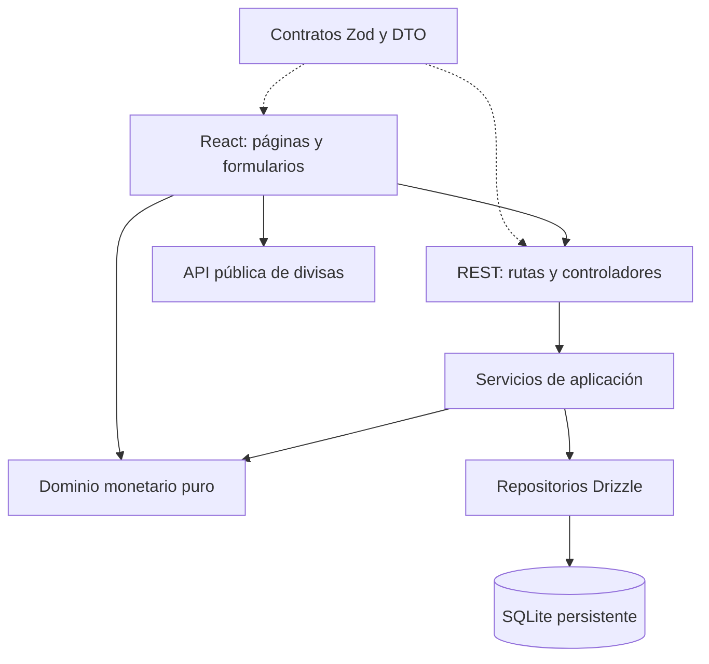

# Arquitectura propuesta

Referencia de decisión: D11. Monorepo npm workspaces, monolito modular; cuatro unidades: apps/web, apps/api, packages/contracts, packages/billing.

## Stack y alternativas

| Área               | Propuesta                                            | Justificación y alternativa                                                                                                                       |
| ------------------ | ---------------------------------------------------- | ------------------------------------------------------------------------------------------------------------------------------------------------- |
| Runtime            | Node 24 LTS + TypeScript strict, ESM                 | Línea LTS; fijar parche en la instalación y probar Windows/CI. No exigir “latest”                                                                 |
| Frontend           | React + Vite                                         | SPA interactiva; SSR/Next no aporta al panel interno                                                                                              |
| Navegación         | React Router                                         | Cuatro rutas, deep links y retorno; evita navegación artesanal                                                                                    |
| Estilo             | CSS Modules + variables CSS                          | Pocas pantallas, tokens explícitos y sin configuración Tailwind adicional. No añadir shadcn/UI salvo necesidad justificada                        |
| Formularios/estado | React, fetch y hooks acotados                        | Sin Redux ni librería server-state inicial; Zod comparte fronteras                                                                                |
| API                | Express 5 + Zod                                      | Familiar, pequeño, Supertest directo; safeParse en frontera. Fastify es alternativa válida con inject/schema, pero no necesario para este volumen |
| SQLite             | Drizzle + better-sqlite3                             | Schema TS y SQL migrable inspeccionable. Driver síncrono suficiente en demo de una instancia; revisar binarios Windows                            |
| Alternativas DB    | Prisma / SQL directo                                 | Prisma añade generación/abstracción no necesaria; SQL directo viable pero exige disciplina manual de tipos/migraciones                            |
| Tests              | Vitest, Supertest, RTL + user-event, Playwright Test | Funciones puras, API con DB real temporal, componentes y flujos completos                                                                         |
| Calidad            | ESLint, TypeScript y formato consistente             | Evitar meta-frameworks y turborepo inicialmente                                                                                                   |

No instalar versiones RC por copiar el primer ejemplo de documentación. En 001 registrar versiones estables compatibles, peer dependencies y lockfile. No se ha creado package.json.

## Componentes y flujo

La flecha UI→dominio permite preview instantáneo usando el MISMO paquete puro. API recalcula al guardar con el país/plan del cliente obtenido de DB y configuración fiscal del servidor. Nunca toma precio, impuesto o país del cuerpo de simulación. El frontend recibe la versión fiscal por GET /billing-config; si cambia, devuelve cálculo autoritativo y avisa de la diferencia.

## Capas

- Rutas: método, path, middleware. Controladores: parsear request y mapear resultado HTTP.
- Servicios: caso de uso, recuperar cliente, cargar política, transacción y orquestación.
- Dominio: tramos, impuesto, redondeo y conversión; sin DB, red, fecha global ni React.
- Repositorios por feature: SQL parametrizado, mapeo fila/DTO, sin respuesta HTTP.
- Contratos: schemas request/response, códigos de error y tipos inferidos; no tipos ORM filtrados al navegador.
- UI por features customers/simulations; componentes comunes solo cuando existen usos repetidos.

No crear interfaces genéricas de repositorio, contenedor DI, buses o DDD ceremonial. Inyectar conexión DB y reloj a factorías pequeñas para pruebas.

## Errores

Envelope único: error.code, error.message, error.fields?, error.requestId. 400 JSON/query inválido; 422 validación semántica; 404 recurso ausente; 409 fiscal duplicado; 503 SQLite ocupado transitorio; 500 inesperado. No SQL, stack ni PII en respuesta. Middleware final de errores, logs con requestId y metadatos mínimos.
UI mantiene entradas, muestra campo afectado o alerta; reintentos explícitos, no reintentar POST automáticamente tras respuesta incierta.

## Variables previstas

| Variable          | Proceso | Valor de desarrollo propuesto         | Regla                                                   |
| ----------------- | ------- | ------------------------------------- | ------------------------------------------------------- |
| NODE_ENV          | API     | development                           | Validar enum                                            |
| PORT              | API     | 3001                                  | Puerto válido                                           |
| HOST              | API     | 127.0.0.1                             | Publicar solo tras autorización                         |
| DATABASE_PATH     | API     | ./data/dev.sqlite                     | Resolver contra raíz API documentada; fuera de web root |
| WEB_ORIGIN        | API     | http://localhost:5173                 | CORS exacto, no wildcard con credenciales               |
| VITE_API_BASE_URL | Web     | http://localhost:3001                 | Pública, nunca secretos                                 |
| VITE_FX_URL       | Web     | https://open.er-api.com/v6/latest/EUR | Endpoint fijo permitido, no URL arbitraria de usuario   |

.env.example se creará en 001 sin secretos; .env, DB, WAL/SHM, logs y trazas quedan ignorados. Tests sobrescriben DATABASE_PATH a temporal único y fallan si coincide con desarrollo. Variables VITE son públicas.

## Desarrollo y entrega

Dos terminales en local, Vite y API; SQLite se crea por migración explícita. npm workspaces y lock único permiten instalación reproducible. Servir dist web y API en mismo origen en demo es una opción simple, con fallback SPA solo para rutas web y nunca para errores API.
Despliegue: instancia Node con volumen persistente para DB y backups verificados; no SQLite en disco efímero serverless ni archivo compartido por múltiples réplicas. La base no se expone a Internet: el evaluador accede por API/UI o ejecuta localmente.
No se elige proveedor ni coste en esta fase. No se configura servicio.

## Decisiones relacionadas

[ADR únicos](../ai-workspace/decisions/README.md), [modelo](data-model.md), [contratos](api-contracts.md), [repositorio](repository.md).
Fuentes técnicas verificadas: [Vite](https://vite.dev/guide/), [Node LTS](https://nodejs.org/en/about/previous-releases), [Express errores](https://expressjs.com/en/5x/guide/error-handling/), [Zod](https://zod.dev/basics), [Drizzle SQLite](https://orm.drizzle.team/docs/get-started/sqlite-new), [migraciones](https://orm.drizzle.team/docs/migrations). Elección del stack: criterio propio, no requisito Roams.
