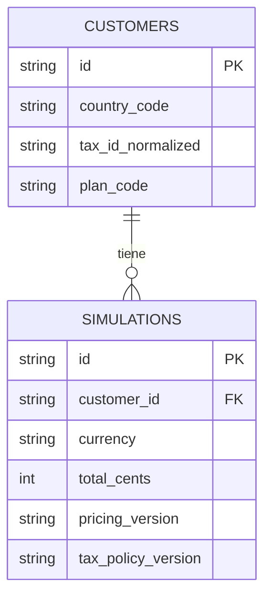

# Modelo de datos de SaaS-O-Matic

## 1. Propósito y alcance

Este documento define las entidades, relaciones y restricciones lógicas que debe respetar la información del producto. Debe orientar especificaciones y consumidores sin constituir un historial de migraciones o una copia del esquema físico.

Se distinguen el **modelo de negocio**, sus **reglas de integridad** y los **mecanismos técnicos de persistencia**. La selección de SQLite y Drizzle es contexto arquitectónico, no una entidad ni regla comercial.

El [diccionario vinculante de 002](../specs/002-persistence/spec.md#diccionario-vinculante) conserva su autoridad para el alcance de persistencia. La [decisión 003-C01](../specs/003-customers-api/clarifications.md) concreta la excepción vigente de contacto opcional y alta de cinco campos. Este documento integra esas fuentes sin sustituirlas ni afirmar que todas las decisiones precedieron al desarrollo.

## 2. Entidades y estructuras de dominio

| Elemento            | Naturaleza                                  | Responsabilidad                                                                                                            |
| ------------------- | ------------------------------------------- | -------------------------------------------------------------------------------------------------------------------------- |
| Cliente corporativo | Entidad persistente.                        | Identificar empresa, información de contacto, país y elección de plan.                                                     |
| Simulación          | Entidad persistente vinculada a un cliente. | Conservar consumos y resultado económico confirmado con su contexto.                                                       |
| Snapshot de cliente | Estructura incluida en la simulación.       | Conservar la identidad y condiciones del cliente utilizadas al calcular. No tiene identidad o ciclo de vida independiente. |
| Desglose de precios | Colección embebida en la simulación.        | Conservar cantidades, precios unitarios y subtotales aplicados. No constituye una tabla de tarifas.                        |

Planes, países y tasas fiscales no deberán convertirse en entidades independientes sin una decisión de alcance. Los planes son códigos del catálogo demo y la política fiscal es configuración versionada. Los metadatos de propiedad de archivo y seguimiento del esquema son técnicos, no entidades de producto ni datos de sus DTO.

## 3. Relaciones

Un cliente puede tener cero o muchas simulaciones. Cada simulación deberá pertenecer exactamente a un cliente existente mediante `customer_id` → `customers.id`.

El diagrama muestra una selección de atributos, no el esquema completo. Snapshot y desglose forman parte del contenido de cada simulación, sin claves foráneas a tablas propias. La referencia al cliente no sustituye el snapshot: los datos actuales y el hecho histórico tienen responsabilidades distintas.

No deberán existir simulaciones huérfanas ni cascadas destructivas. La relación deberá impedir eliminar o cambiar la clave del cliente referido, conforme a las restricciones aprobadas.

## 4. Diccionario lógico de datos

Los nombres de almacenamiento se conservan en snake_case; los contratos públicos emplean sus nombres camelCase definidos en [API](api-contracts.md). UUID, texto, instante e importe son tipos lógicos; no implican por sí solos un tipo de un lenguaje o una garantía SQL completa.

### Cliente — customers

| Atributo            | Tipo lógico        | Obligatorio | Significado y restricciones                                                                                                                    |
| ------------------- | ------------------ | ----------- | ---------------------------------------------------------------------------------------------------------------------------------------------- |
| `id`                | UUID               | Sí          | Identidad estable generada por el sistema; clave primaria.                                                                                     |
| `company_name`      | Texto              | Sí          | Empresa, recortada, 1–200 caracteres; el alta aplica normalización NFC.                                                                        |
| `tax_id_original`   | Texto              | Sí          | Escritura original recortada, 1–64; conserva ceros iniciales.                                                                                  |
| `tax_id_normalized` | Texto              | Sí          | Normalización del original: trim y mayúsculas, 1–64. Forma la identidad única junto con país.                                                  |
| `contact_name`      | Texto opcional     | No          | Dato de contacto nominal conservable cuando exista; si está presente, recortado y de 1–200. No debe inventarse ni exigirse en el alta pública. |
| `contact_email`     | Texto              | Sí          | Email de contacto recortado, 1–254, no único; validación de nueva alta según contrato.                                                         |
| `country_code`      | Código             | Sí          | Dos letras ASCII mayúsculas. No certifica pertenencia a ISO o soporte fiscal.                                                                  |
| `plan_code`         | Código de catálogo | Sí          | `DEMO_BASIC` o `DEMO_PRO`, sin multiplicador comercial.                                                                                        |
| `created_at`        | Instante UTC       | Sí          | Fecha real ISO-8601 con milisegundos.                                                                                                          |

La obligatoriedad opcional de `contact_name` procede de 003-C01; la tabla original de 002 conserva el requisito de su ámbito inicial. El alta y el DTO de cliente no incluyen ese campo. El modelo no incorpora `updated_at` ni supone operaciones de edición.

### Simulación — simulations

Todos los atributos siguientes son obligatorios. Un límite superior null en una línea de desglose no vuelve opcional a la colección.

| Atributo                 | Tipo lógico         | Significado y restricciones                                                      |
| ------------------------ | ------------------- | -------------------------------------------------------------------------------- |
| `id`                     | UUID                | Identidad única generada por el sistema.                                         |
| `customer_id`            | UUID de cliente     | Referencia obligatoria a `customers.id`.                                         |
| `users`                  | Entero              | Usuarios activos, 0–1000.                                                        |
| `storage_gb`             | Entero              | Almacenamiento en GB, 0–10000.                                                   |
| `api_calls`              | Entero              | Llamadas estimadas, 0–10000000.                                                  |
| `currency`               | Código de moneda    | Siempre `EUR`.                                                                   |
| `base_cents`             | Importe entero      | Base calculada, no negativa y dentro del rango seguro.                           |
| `tax_cents`              | Importe entero      | Impuesto aplicado, no negativo y seguro.                                         |
| `total_cents`            | Importe entero      | Suma exacta de base e impuesto, segura.                                          |
| `customer_name_snapshot` | Texto               | Nombre de empresa al calcular, recortado, 1–200.                                 |
| `tax_id_snapshot`        | Texto               | Identificador fiscal normalizado al calcular, 1–64.                              |
| `country_code_snapshot`  | Código              | País del cliente utilizado para la simulación, dos letras mayúsculas.            |
| `plan_code_snapshot`     | Código de catálogo  | Plan del cliente al calcular.                                                    |
| `pricing_version`        | Texto               | Identificador de reglas de precios aplicadas, recortado, 1–64.                   |
| `tax_policy_version`     | Texto               | Identificador de política fiscal aplicada, recortado, 1–64.                      |
| `tax_rate_bps`           | Entero              | Tasa aplicada en puntos básicos, 0–10000. Su rango no aprueba una tasa concreta. |
| `breakdown_json`         | Colección de líneas | Desglose estructurado del resultado, almacenado como array JSON válido.          |
| `created_at`             | Instante UTC        | Fecha de creación ISO-8601 con milisegundos.                                     |

Los importes deberán pertenecer al intervalo 0–9007199254740991. No se utilizará un valor fraccionario para representar céntimos. Los tipos físicos, índices y comprobaciones adicionales están en el diccionario de 002.

### Línea de desglose

Cada línea deberá contener exactamente los atributos siguientes:

| Atributo lógico  | Tipo y obligatoriedad                | Restricción                                              |
| ---------------- | ------------------------------------ | -------------------------------------------------------- |
| `tierFrom`       | Entero obligatorio                   | Mayor o igual a 1.                                       |
| `tierTo`         | Entero o null, propiedad obligatoria | Mayor o igual a tierFrom; null representa tramo abierto. |
| `quantity`       | Entero obligatorio                   | Mayor que 0 y como máximo 1000.                          |
| `unitPriceCents` | Importe entero obligatorio           | No negativo y seguro.                                    |
| `subtotalCents`  | Importe entero obligatorio           | Producto exacto de cantidad y precio unitario.           |

Todos los números deberán ser enteros seguros. La suma de cantidades deberá coincidir con users y la suma de subtotales con base_cents. Con cero usuarios, el desglose deberá ser vacío y la base cero. La colección pública `breakdown` representa estos datos como estructuras, sin exponer un string `breakdownJson`.

## 5. Restricciones de negocio e integridad

- **Identidad:** cada entidad tendrá UUID válido e instante real de creación; no se confiará solo en longitud o apariencia del texto.
- **Unicidad:** país e identificador fiscal normalizado deberán ser únicos en conjunto. Nombre y email podrán repetirse. Una comprobación previa no sustituye la garantía de unicidad concurrente.
- **Normalización:** original recortado y normalizado deberán corresponder, sin pérdida de ceros. Las nuevas altas españolas aplicarán además BR04; los registros previos no deberán revalidarse o eliminarse automáticamente por introducir una política de alta.
- **Referencias:** una simulación no podrá referir un cliente inexistente. Las referencias no autorizarán borrado en cascada.
- **Consumos y planes:** límites y catálogo deberán respetar BR02, sin cuotas o precios adicionales inferidos del almacenamiento.
- **Dinero:** base e impuesto deberán sumar total dentro del rango seguro; el desglose deberá corresponder a consumos y base. Las fórmulas y redondeos pertenecen a BR01/BR03.
- **Contexto:** cliente, resultado y snapshot deberán corresponder al mismo estado de cálculo. Las versiones y la tasa aplicada deberán quedar asociadas al hecho guardado.
- **Inmutabilidad:** las simulaciones deberán conservar sus datos originales; ni cambio de política ni consulta deberán actualizar sus importes o snapshots.

La integridad estructural no sustituye el cálculo de negocio. Almacenar una tasa dentro de su rango no la convierte en política aprobada, ni un identificador bien formado acredita existencia censal.

## 6. Snapshots históricos y datos derivados

Cada simulación deberá conservar una instantánea del nombre de empresa, identificador fiscal normalizado, país y plan utilizados al calcular. No se incluirán email o nombre de contacto como snapshots sin una ampliación aprobada.

La base, impuesto, total y desglose son **datos calculados que deben persistirse** como resultado confirmado. Las versiones de precios e impuestos y la tasa aplicada permiten identificar sus condiciones; no implican almacenar un catálogo completo de reglas ni ejecutar nuevamente el cálculo al leer.

Una modificación posterior de datos del cliente o configuración no deberá sustituir el contexto histórico. El vínculo con el cliente permite localizar sus simulaciones; el snapshot conserva el hecho original.

La previsualización editable y los importes convertidos para visualización son distintos del registro persistido. No deberán almacenarse moneda elegida, proveedor o tasa FX en la simulación. Una conversión actual del histórico no debe confundirse con el cambio disponible en su fecha de creación.

## 7. Ciclo de vida de los datos

El cliente deberá crearse con la información obligatoria validada y su identidad fiscal normalizada. Sus datos se podrán consultar y buscar sin que esa lectura cambie el registro. La existencia de campos de contacto conservables no amplía el formulario aprobado.

La simulación deberá originarse en un cliente existente y consumos admitidos. Tras el cálculo autoritativo, resultado y contexto deberán guardarse de forma coherente; una operación fallida anterior a la confirmación no dejará datos parciales.

El histórico deberá sobrevivir a recargas y reinicios y presentar los resultados guardados, en orden estable por fecha e identificador descendentes. Un cliente podrá existir sin simulaciones.

Las simulaciones serán append-only. El MVP no ofrece edición o eliminación de simulaciones ni edición o eliminación de clientes. No se deberán introducir operaciones CRUD por el hecho de que una entidad tenga identidad propia.

Dos guardados deliberados podrán representar dos simulaciones distintas. Ante comunicación incierta se deberá comprobar lo persistido sin suponer que el registro no existe ni generar automáticamente otro.

## 8. Principios de persistencia

La persistencia deberá reforzar integridad referencial, unicidad, rangos y coherencia histórica, además de las validaciones de aplicación. Las comprobaciones de SQL no acreditan por sí solas formato fiscal, validez completa de fechas o estructura detallada del desglose.

Datos persistidos de negocio, fixtures de pruebas y archivos temporales deberán permanecer separados. Los datos demo deberán ser ficticios e identificables como tales; no acreditan clientes reales. No se deberán versionar bases, backups o información sensible ni modificar datos existentes mediante operaciones destructivas implícitas.

La inicialización y evolución del almacenamiento deberán ser explícitas y preservar datos y garantías aprobadas. Los archivos ajenos no deberán adoptarse automáticamente. Metadatos de propiedad y seguimiento del esquema pertenecen a la persistencia técnica y no ampliarán el modelo público.

Los procedimientos de migración, configuración, backup y recuperación corresponden a arquitectura y operación; no forman parte del ciclo de vida funcional de las entidades.

## 9. Referencias y límites documentales

- [Producto](product.md) y [requisitos](requirements.md): necesidades, alcance y criterios que justifican la información.
- [Reglas de negocio](business-rules.md): normalización, precios, impuestos, divisas y conservación.
- [Contratos API](api-contracts.md): estructuras públicas, nombres camelCase, validaciones y respuestas; no son modelos ORM.
- [Diccionario vinculante 002](../specs/002-persistence/spec.md#diccionario-vinculante): convenciones y restricciones físicas detalladas; este documento no lo sustituye automáticamente.
- [Clientes 003](../specs/003-customers-api/spec.md) y [aclaraciones](../specs/003-customers-api/clarifications.md): cinco campos públicos, fiscal y contacto nominal opcional.
- [Facturación 004](../specs/004-billing/spec.md): resultado económico y versiones; persistencia no determina precios o impuestos.
- [Simulaciones 005](../specs/005-simulations-api/spec.md): coherencia del guardado, snapshots y lectura del resultado original.
- [Arquitectura](architecture.md): materialización técnica y operación. [Esquema](../apps/api/src/db/schema.ts) y [migraciones](../apps/api/drizzle/) permiten contrastar nombres y garantías sin redefinir por sí solos el modelo aprobado.
