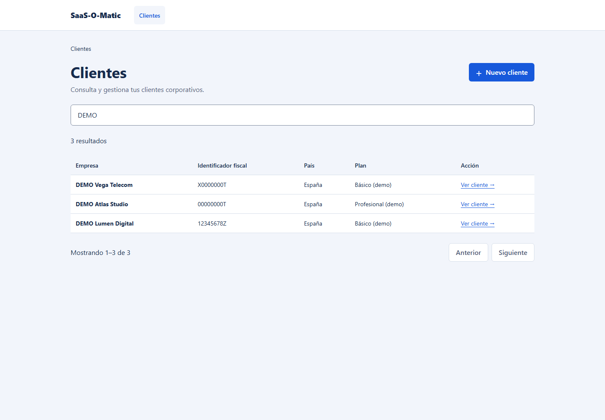
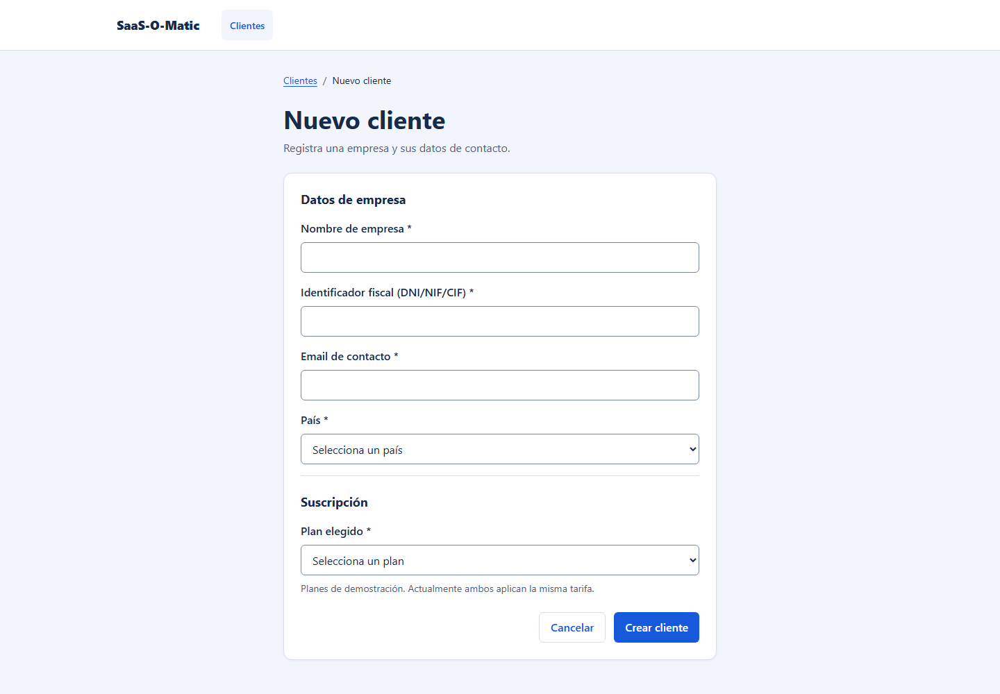
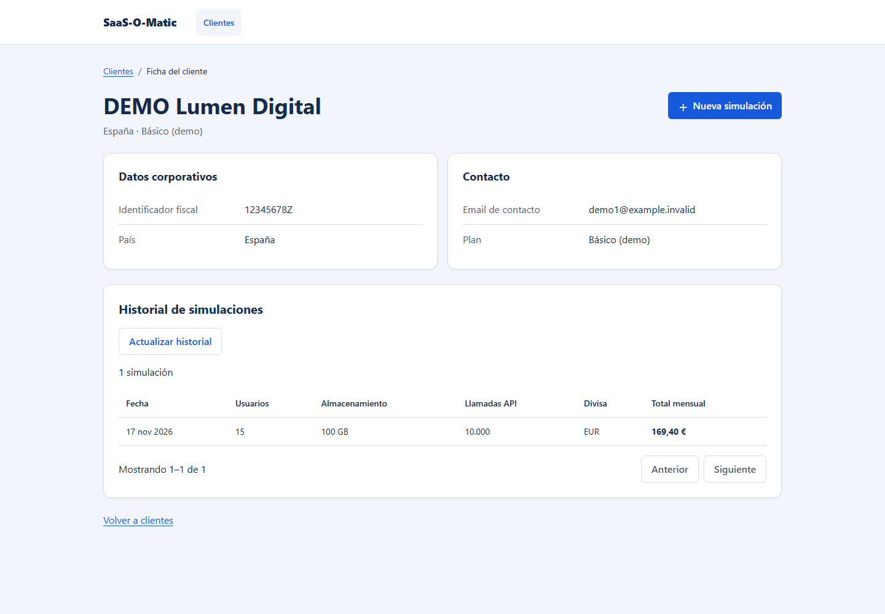
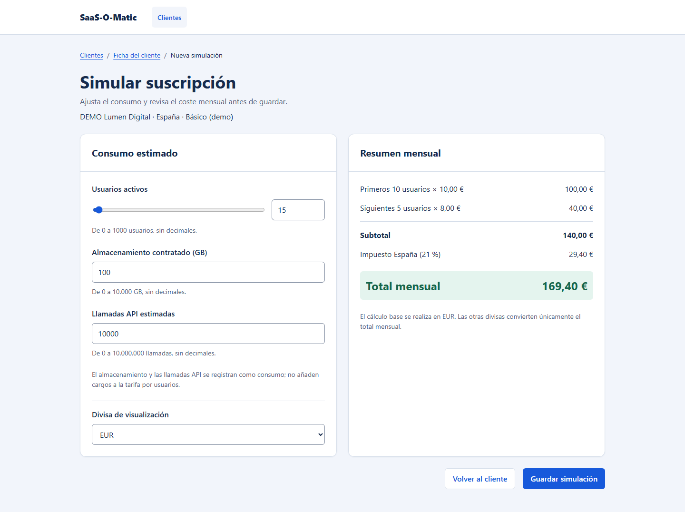

# Referencia de diseño UX/UI — SaaS-O-Matic

## 1. Visión general

SaaS-O-Matic está orientado al comercial que registra empresas y prepara estimaciones mensuales de suscripción. La interfaz conecta clientes, presupuesto e historial en un recorrido continuo, con textos en español y acciones explícitas.

La experiencia se apoya en cuatro principios:

- **Claridad:** priorizar el cliente, los consumos y el importe mensual; explicar los límites y las condiciones de cálculo junto a los controles.
- **Confianza:** distinguir presupuesto previo de resultado guardado, señalar discrepancias y no presentar como confirmado un guardado incierto.
- **Eficiencia:** buscar, navegar y volver conservando el contexto; sincronizar controles de consumo y actualizar el presupuesto sin guardar automáticamente.
- **Trazabilidad:** consultar importes históricos persistidos y reconocer el cliente y los datos asociados a cada confirmación.

Esta referencia describe el producto implementado. Los requisitos y decisiones de alcance se conservan en las specs de [clientes](../specs/007-customers-ui/spec.md) y [simulador](../specs/008-simulator-ui/spec.md); las ejecuciones y resultados de QA pertenecen a sus documentos de validación.

## 2. Lenguaje visual

Tema claro con fondo suave, superficies blancas y azul para acciones. La fuente ejecutable de valores compartidos es [tokens.css](../apps/web/src/styles/tokens.css); [global.css](../apps/web/src/styles/global.css) define la base transversal y los estilos locales se organizan mediante CSS Modules. No se utiliza Tailwind, una librería UI ni una tipografía descargada.

### Color semántico

| Token                     | Valor     | Función                               |
| ------------------------- | --------- | ------------------------------------- |
| `--color-text`            | `#172b4d` | Texto principal y títulos.            |
| `--color-text-muted`      | `#526179` | Descripciones, ayudas y metadatos.    |
| `--color-background`      | `#f2f5fb` | Fondo general.                        |
| `--color-surface`         | `#ffffff` | Paneles y controles.                  |
| `--color-border`          | `#d6deea` | Divisores y bordes decorativos.       |
| `--color-control-border`  | `#7b879c` | Delimitación de inputs y selectores.  |
| `--color-action`          | `#1759db` | Enlaces y acciones principales.       |
| `--color-action-hover`    | `#1044ad` | Acción principal al pasar el puntero. |
| `--color-on-action`       | `#ffffff` | Texto sobre acción principal.         |
| `--color-focus`           | `#123fa0` | Indicador de foco de teclado.         |
| `--color-danger`          | `#b42318` | Errores y campos inválidos.           |
| `--color-success`         | `#16664b` | Énfasis del total mensual.            |
| `--color-success-surface` | `#e4f4ee` | Fondo del total destacado.            |

El color acompaña a texto y semántica; no sustituye la explicación de un error, progreso o confirmación. El total destacado no implica que el presupuesto ya se haya guardado.

### Tipografía, ritmo y superficies

La familia es `system-ui, -apple-system, BlinkMacSystemFont, 'Segoe UI', sans-serif`. El cuerpo utiliza `1rem`, texto secundario `0.875rem` e interlineado `1.5`. El título principal escala con `clamp(1.75rem, 4vw, 2.25rem)` e interlineado `1.2`. Las cabeceras de sección usan jerarquía y peso propios de cada panel; el total mensual utiliza `1.5rem`, con cifras tabulares para facilitar la comparación.

La escala de espacios compartida es `0.25`, `0.5`, `0.75`, `1`, `1.5`, `2` y `3rem`. Los radios son `0.375rem` para controles y `0.75rem` para paneles. Las superficies combinan borde fino y sombra `0 1px 3px rgb(23 43 77 / 6%)`.

El contenido tiene ancho máximo de `72rem`; el alta se limita a `42rem`. Los controles emplean una altura mínima de `2.75rem`. El foco visible usa un contorno de `3px` y separación de `3px`.

## 3. Estructura y navegación

La aplicación utiliza cabecera superior con marca y acceso a Clientes, sin sidebar ni dashboard global. El contenido está centrado y comienza con breadcrumbs, título y descripción. Las acciones principales se sitúan junto al encabezado cuando corresponde; en espacios estrechos pasan a otra línea.

| Ruta                             | Destino                            |
| -------------------------------- | ---------------------------------- |
| `/`                              | Redirección a Clientes.            |
| `/customers`                     | Listado y búsqueda.                |
| `/customers/new`                 | Alta de cliente.                   |
| `/customers/:id`                 | Ficha e historial.                 |
| `/customers/:id/simulations/new` | Simulación contextual del cliente. |

Las rutas desconocidas ofrecen un estado de página no encontrada con retorno a clientes. Los breadcrumbs enlazan niveles reales. La búsqueda y la página del listado se reflejan en la URL; al regresar desde alta o ficha se conserva el contexto. El historial mantiene su propia página. Un acceso directo dispone de un retorno seguro aunque no exista navegación previa.

El simulador muestra la empresa, país y plan como contexto; no exige seleccionar de nuevo un cliente ni ofrece modificar su país para alterar el precio.

## 4. Patrones de componentes

**Acciones.** La acción principal utiliza fondo azul, texto blanco y etiqueta explícita. Las secundarias emplean superficie blanca o enlaces según su jerarquía. «+ Nuevo cliente» y «+ Nueva simulación» incorporan un signo decorativo, sin cambiar su nombre accesible. Las acciones pueden reorganizarse en varias líneas.

**Formularios.** Etiquetas persistentes, campos de ancho disponible, ayudas junto al control y errores asociados. Los obligatorios están identificados. El alta agrupa Datos de empresa y Suscripción en una sola página; no utiliza un asistente de pasos. Los errores de envío se presentan en un resumen enlazado a los campos y junto al dato afectado.

**Tarjetas y paneles.** Superficies blancas delimitan grupos de información y separan cabecera y contenido cuando procede. La ficha distingue Datos corporativos, Contacto e Historial. El simulador separa Consumo estimado y Resumen mensual.

**Listados.** Tablas con cabeceras, nombre de empresa destacado, acciones textuales y paginación Anterior/Siguiente. En móvil las filas se presentan como bloques con etiquetas, conservando los datos. El historial muestra consumos e importe EUR guardado; no ofrece una acción de detalle individual inexistente.

**Consumos y desglose.** Usuarios combina slider nativo y campo numérico sincronizados; almacenamiento y llamadas usan campos con unidades y límites visibles. El resumen alinea conceptos e importes, separa subtotal e impuesto y destaca el total. Las líneas se expresan en EUR, incluso cuando se convierte el total.

**Feedback.** Mensajes de carga, vacío, error y confirmación describen el estado y ofrecen la siguiente acción cuando existe. No se presupone un sistema de skeletons o toasts: la implementación emplea mensajes y paneles de estado.

## 5. Pantallas y recorridos

### Listado y búsqueda

El título Clientes y «+ Nuevo cliente» encabezan la página. Debajo aparecen búsqueda por empresa o identificador fiscal, total de resultados, listado y paginación de 20 registros. La búsqueda se confirma tras 250 ms sin introducir una entrada de historial por cada tecla y vuelve a la primera página.

Se distinguen ausencia de clientes, búsqueda sin coincidencias y página fuera de resultados. La tabla muestra empresa, identificador fiscal, país, plan y Ver cliente; no incluye Última simulación ni estadísticas sin soporte.

### Alta de cliente

Formulario central de cinco campos: empresa, identificador fiscal, email, país y plan. El país procede de la configuración disponible; los planes se presentan como Básico (demo) y Profesional (demo), aclarando que aplican la misma tarifa. No se inventan prestaciones comerciales.

Cancelar recupera el listado contextual. Crear cliente valida el formato y solicita el control fiscal al backend. Durante el envío se bloquean campos y acciones y se anuncia progreso. Tras confirmación válida se abre la ficha y se comunica el éxito.

### Ficha e historial

La empresa es el título; país y plan aportan contexto. «Nueva simulación» conduce al simulador del cliente. Dos tarjetas presentan datos corporativos y contacto; debajo se consulta el historial paginado con fecha, usuarios, almacenamiento, llamadas, divisa y total mensual.

Datos del cliente e historial tienen estados independientes: un fallo del historial no oculta la ficha. Actualizar historial permite comprobar nuevos registros conservando la página; el retorno mantiene la búsqueda previa. Los importes históricos no se recalculan ni se convierten.

### Simulador de presupuestos

Dos paneles en escritorio y una columna en espacios menores: controles a la izquierda y resumen a la derecha. Una simulación nueva comienza con tres consumos a cero y EUR. Usuarios admite de 0 a 1.000, almacenamiento hasta 10.000 GB y llamadas hasta 10.000.000, sin decimales. La interfaz explica que almacenamiento y llamadas se registran, pero no añaden cargos.

El presupuesto cambia con consumos válidos sin peticiones de guardado por cada movimiento. Una entrada inválida retira el presupuesto vigente y bloquea guardar. Cliente, país o configuración incompatibles muestran un bloqueo comprensible con recuperación, sin presentar precios de reserva inventados.

### Resultado y confirmación

Guardar simulación permanece junto a Volver al cliente. Durante el envío se bloquean consumos y divisa. Tras confirmar se permanece en la pantalla: el resumen pasa a Resultado guardado y se presenta información del cliente y fecha guardados.

Los consumos quedan bloqueados para distinguir el registro confirmado de un nuevo borrador. Es posible cambiar la divisa de visualización. Preparar otra simulación inicia explícitamente un borrador cero/EUR y vuelve a consultar cliente y configuración. Volver al cliente permite consultar el historial actualizado.

## 6. Patrones de interacción

- **Carga:** anunciar qué se está obteniendo o enviando. Si la configuración necesaria no está disponible, explicar el bloqueo y permitir reintentar conservando lo introducido.
- **Vacío:** explicar la ausencia de datos sin confundirla con error o falta de coincidencias. Cero usuarios es una entrada válida, no un formulario vacío.
- **Error:** conservar datos recuperables, asociar errores de campo y ofrecer reintentos explícitos. Diferenciar cliente inexistente de indisponibilidad temporal.
- **Éxito:** navegar a la ficha tras crear cliente; permanecer en el resultado confirmado tras guardar simulación. No insertar filas ficticias como si estuvieran confirmadas.

El envío pendiente impide duplicar la misma acción. Un fallo de red, timeout o respuesta de éxito ilegible puede dejar el guardado incierto: se explica la posibilidad y se ofrece comprobar clientes o historial en otra pestaña, manteniendo el formulario original. No se reenvía automáticamente.

La previsualización es orientativa; el resultado del servidor es definitivo para ese registro. Una discrepancia muestra el importe previo y el guardado en EUR y conserva el aviso al volver a la ficha dentro del contexto de navegación. El registro no se modifica para hacerlo coincidir con el preview.

EUR/USD/GBP afecta únicamente al total del simulador o del resultado confirmado. La conversión muestra carácter orientativo, fecha y atribución del proveedor. Si falla o caduca, se retira la conversión, se identifica el total EUR y se ofrece Reintentar conversión. Ese fallo no impide un guardado EUR válido y reintentar FX no repite el guardado.

## 7. Responsive y accesibilidad

Los layouts usan anchos fluidos y permiten ajustar textos largos sin truncar la identidad del cliente ni ensanchar la página. No existe una composición de tablet independiente: el espacio disponible determina el reflujo.

- Hasta `48rem`, el simulador pasa de dos columnas a una.
- Hasta `40rem`, se reducen márgenes y rellenos, las tarjetas de ficha se apilan y las tablas se presentan como bloques etiquetados. Los controles del slider conservan su campo numérico junto a él.
- Hasta `25rem`, las filas del desglose permiten separar concepto e importe en varias líneas. Las acciones admiten salto de línea y los datos importantes permanecen visibles.

La navegación incluye salto al contenido, landmarks y encabezados jerárquicos. Enlaces, botones, campos, selectores y slider son operables por teclado. Al cambiar de ruta se enfoca el encabezado principal sin dibujar un contorno sobre el título; los controles interactivos conservan foco visible. Los resúmenes de error y confirmaciones reciben foco cuando corresponde. Al paginar se recupera una posición útil si desaparece el control, sin desplazar una selección posterior del usuario.

Las etiquetas, ayudas y errores se asocian mediante semántica HTML y atributos accesibles. Los estados se anuncian sin convertir cada cambio de precio del slider en una interrupción. Se respeta la preferencia de movimiento reducido en el comportamiento transversal.

El criterio de diseño es WCAG 2.2 AA: contraste mínimo de 4,5:1 para texto normal y 3:1 para controles e indicadores relevantes, foco perceptible y contenido utilizable al ampliar. Estos objetivos no constituyen certificación. Alcance y métodos realmente comprobados —incluidos los límites de ampliación, navegador y tecnologías de apoyo— permanecen en la [validación de calidad](../specs/009-quality/validation.md).

## 8. Referencias visuales

Las siguientes imágenes son **capturas de la implementación con datos ficticios**, conservadas en el repositorio. Ilustran estados concretos de escritorio; sus valores y nombres no son datos obligatorios, estados iniciales ni una especificación de todos los errores o tamaños.

### Listado de clientes

### Alta de cliente

### Ficha e historial

### Simulador

interfaces.pdf fue la referencia de composición aportada durante la definición de interfaces. No está incluido en el repositorio y no se presenta como un recurso disponible para otro entorno. Sus ejemplos se adaptaron al producto: planes demo existentes, ausencia de Última simulación y de detalle individual de simulación.
